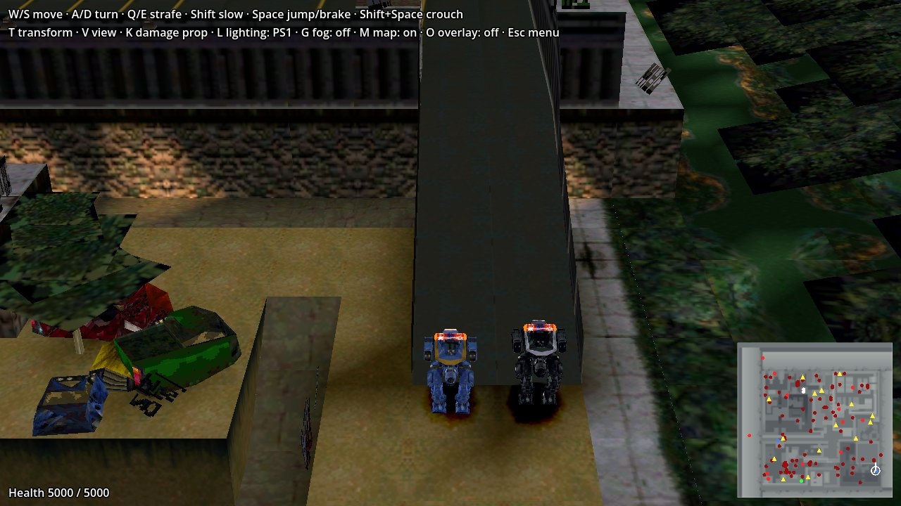
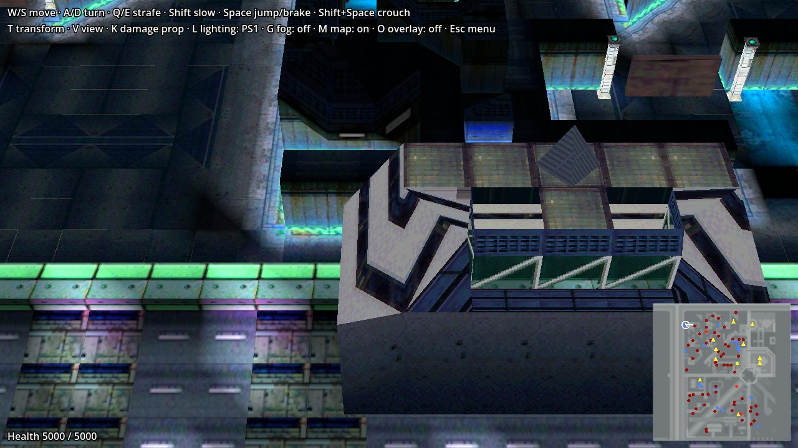
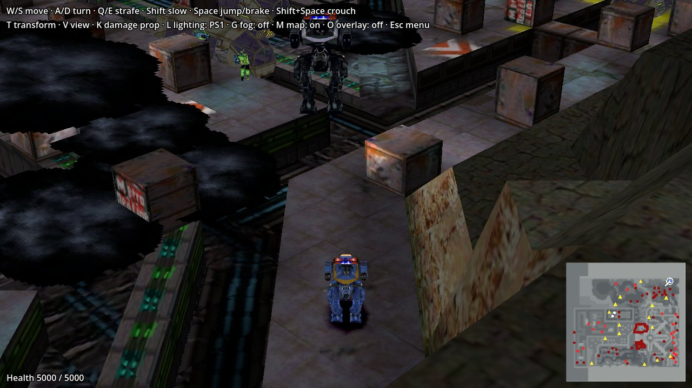
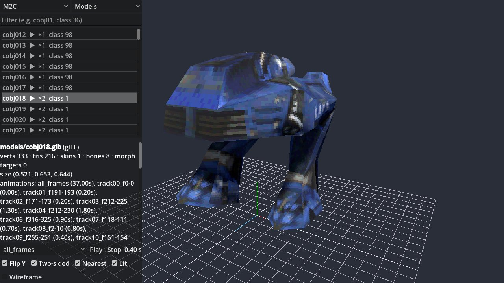
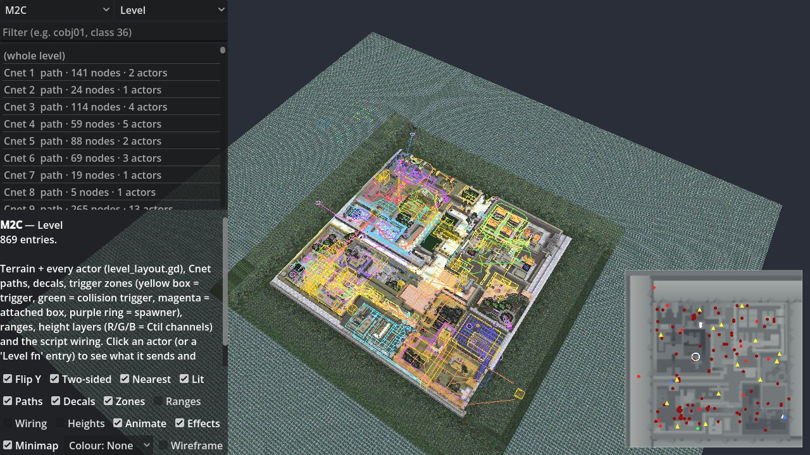

# Future Cop: L.A.P.D. — asset extraction & viewer

Reverse-engineering the PS1 game *Future Cop: L.A.P.D.* (EA, 1998). Python tools decode
every asset format on the disc, and a Godot 4 asset viewer shows all of it. The viewer
covers models with their animations, terrain, actors and AI paths, textures and UI art,
fonts, audio, FMV movies, and the decoded level data.

Format knowledge lives in each tool's module docstring, which is the source of truth for
that binary layout. `CLAUDE.md` holds the working notes: pipeline details, hard-won
format facts and open questions.



| | |
|---|---|
|  |  |
|  |  |

The walkable level scenes (top: M2C, LAX1, UN) and the asset viewer (bottom: an
animated model, and a whole level with its actors, paths and trigger zones).

## Layout

```
parsed/    everything the tools extract, one folder per level (+ parsed/video/)
tools/     the extractors (Python) and lib/ shared helpers
godot/     Godot 4.6 project: the asset viewer and a walkable scene for each level
```

The game itself stays outside the repo, in its parent folder:

```
../Future Cop - L.A.P.D. (USA).iso       PS1 disc image
../future_cop_lapd.img/.ccd/.sub         PC disc image (CloneCD; a Windows + Mac hybrid)
../ps1/                                  PS1 disc contents: CW/ and PA/ level archives (.MIS),
                                         loading screens (.LSC), demos (.DEM), MOVIES/*.WVE,
                                         SLUS_007.39 (the executable)
../pc/windows/                           PC disc, ISO 9660 side (installer, MISSIONS/, …)
../pc/mac/                               PC disc, HFS side (Mac version); files with a
                                         resource fork are stored as MacBinary (.bin)
../ghidra/                               analysed Ghidra project of SLUS_007.39 (PS1 SDK
                                         functions named); decomp.sh decompiles headlessly
```

The tools read `../ps1/` (override with `FCOP_PS1_DIR=/path/to/ps1`). Only code is
committed: `parsed/` and `godot/assets/` are generated from the disc and gitignored.

## Quick start

```sh
python3 -m venv ~/.venvs/fc-lapd && ~/.venvs/fc-lapd/bin/pip install pillow fonttools
~/.venvs/fc-lapd/bin/python -I tools/run_all.py              # ~5 min; --no-videos to skip FMVs
godot --path godot res://scenes/asset_viewer.tscn            # browse everything
```

Run `run_all.py` once before opening the viewer; it fills `parsed/` and `godot/assets/`.
The video step also needs `java` and an `ffmpeg` built with libtheora.

## What's decoded

Every file on the PS1 disc is decoded or accounted for, and all of it can be browsed in the
asset viewer. ✅ decoded · 🟡 mostly decoded · ➖ out of scope

| Data | Status | Notes |
|---|---|---|
| Textures, particles, fonts | ✅ | PNG; fonts also converted to TTF |
| 3D models | ✅ | Skeletons, morphs, animation clips and UV animation, exported as glTF |
| Terrain | ✅ | Heightmaps, tiles, vertex colours, water and special floor types |
| Actors (props, vehicles, enemies, effects…) | 🟡 | 45 classes; 98.3% of bytes decoded, a few fields unknown |
| AI path graphs, spawners, decals | ✅ | |
| Mission scripts (RPN VM) and triggers | 🟡 | Disassembled, and every message and variable that scripts use is named. A few AI modes and variable values are still unexplained |
| Music, voice and sound effects | ✅ | WAV at the game's sample rates; sound tables decoded |
| Front end: menus, sprites, strings, save icon | ✅ | |
| Loading screens | ✅ | MDEC still images |
| FMV movies | ✅ | Via jPSXdec, to Ogg Theora |
| Attract-mode demos | ✅ | Joypad recordings |
| Text in the executable | ✅ | |
| PC / Mac version | ➖ | Out of scope; the PS1 version only |

## Level scenes

Every level except the front end has a walkable scene, `godot/scenes/<LEVEL>_level.tscn`,
with the X1-Alpha at player one's start. It's for exploring the levels, not for playing
them. ✅ works as in the game · 🟡 partly · ❌ not implemented

| Feature | Status |
|---|---|
| Terrain with collision, all props, the level's loading screen | ✅ |
| X1-Alpha movement physics, wall response, walker ↔ hovercraft, crouch, jump, landing damage | ✅ |
| The game's chase camera and its seven views | ✅ |
| Special floors: conveyors, damaging/deadly, slippery, deep water | ✅ |
| Elevators, teleporters (UN), pickups, power-ups | ✅ |
| Vehicles and pedestrians driving their routes | 🟡 They don't react to you |
| Placed effects, decals, animated props, prop damage states (K) | ✅ |
| Water, fog, sphere-map reflections, PS1 or real-time lighting (L) | ✅ |
| Ambient sounds, music, Crime War briefing movies | ✅ |
| Minimap (M) and debug overlay of triggers, paths and floors (O) | ✅ |
| Enemies and combat | ❌ |
| Mission scripts and objectives | ❌ |

**Controls:** W/S walk · A/D turn · Q/E strafe · Shift slow walk · Space jump (brake when
hovering) · Shift+Space crouch · T walker/hovercraft · V camera view · K damage the nearest
prop · L lighting · G fog · M minimap · O overlay · Esc back to the menu.

The `.tscn` files are committed, but they load `godot/assets/`, so run the pipeline first.
Run the project for a level-select menu, or open a level directly:

```sh
godot --path godot                               # menu: pick a level, Esc returns to it
godot --path godot res://scenes/M2C_level.tscn   # one level directly
```

To regenerate a scene:

```sh
~/.venvs/fc-lapd/bin/python -I tools/sync_godot_assets.py    # parsed/ → godot/assets/ (run_all does this too)
godot --headless --path godot --import
godot --headless --path godot --script scripts/generate_scene.gd -- M2C
```

To screenshot a scene from the command line (it needs a display; on a machine without
one, run Godot under Xvfb):

```sh
godot --path godot --resolution 1280x720 --script res://scripts/screenshot.gd \
  -- res://scenes/M2C_level.tscn /abs/out.png
godot --path godot --resolution 1280x720 res://scenes/asset_viewer.tscn \
  -- --level M2C --tab Models --item cobj018 --shot /abs/out.png
```

## From the disc images to `../ps1/` and `../pc/`

```sh
cd ..
7z x -tiso -ops1 "Future Cop - L.A.P.D. (USA).iso"
```

The PC `.img` holds raw 2352-byte Mode 1 sectors, so convert it to 2048-byte sectors first
by keeping bytes 16–2063 of each sector. Then extract each side of the hybrid:
- **Windows:** `7z x -tiso -opc/windows cooked.iso`
- **Mac:** the HFS partition starts at 512-byte block 765. Mount it with hfsutils
  (`hmount`), then copy files out with `hcopy` (`-m` for files with a resource fork).

Toast's "HFS Optimizer" filler files, which have tab and space names, are skipped.

## Credits

- [Future Cop: MIT](https://github.com/Ghoster738/Future-Cop-MIT) by Ghoster738 (MIT
  licence): the open-source reimplementation of the game engine, and the reference that
  several parsers here were ported from. Each docstring says which. Its licence is kept in
  `licenses/Future-Cop-MIT.txt`.
- [jPSXdec](https://github.com/m35/jpsxdec): decodes the EA `.WVE` movies. It's
  downloaded on first use and checksum-verified, not committed.
- [ghidra_psx_ldr](https://github.com/lab313ru/ghidra_psx_ldr): the PS1 loader that the
  Ghidra project in `../ghidra/` needs.

## License

The code and documentation are released under the [MIT License](LICENSE).

This is an unofficial fan project, not affiliated with or endorsed by Electronic Arts.
*Future Cop: L.A.P.D.* and its assets belong to their owners. Apart from the
screenshots, no game data is included: the tools need your own copy of the PS1 disc.
